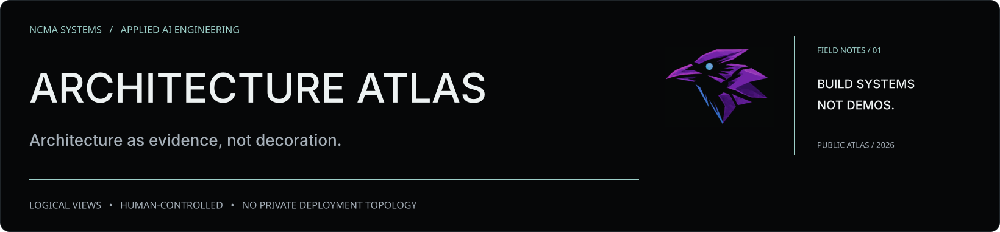

# NCMA Engineering

**Applied AI, agentic systems, deterministic validation and operational engineering.**

This repository is the public engineering portfolio of **Valter Lourenço Junior**. It covers **independent NCMA Systems lab projects** and, in a separately labeled section, **generalized professional engineering work** developed during employment. Each account distinguishes **implemented**, **measured**, **pending**, and **unreleased** claims.

> The aim is not to claim that every subsystem is production-ready. It is to show engineering decisions, failure analysis, verification methods and the reasoning behind them.

**[Professional portfolio](https://ncmasystems.com) · [GitHub profile](https://github.com/Ozzurac) · [LinkedIn](https://www.linkedin.com/in/valter-l-junior/)**

## Projects

| Case study | What it demonstrates | Public artifact |
| --- | --- | --- |
| [Beyond Fine-Tuning: Field Notes 01](projects/beyond-fine-tuning-field-notes-2026.md) | Experiments from ASR adaptation to verified checkpointed agent runtime | **Editorial synthesis with dated evidence and limitations** |
| [Jarvis V2: Local-first AI agent](projects/jarvis-v2.md) | Desktop agency, local model/voice integration, human authorization, execution receipts, product acceptance | Architecture and dated evidence; **not a release** |
| [ModForge V2: Validation against reality](projects/modforge-v2.md) | Parsing, inheritance resolution, schema proof, defect injection and independent runtime probes | Failure analysis and verification methodology |
| [Knowledge Runtime](projects/knowledge-runtime.md) | Persistent evidence, provenance and bounded lexical/vector discovery | Sanitized architectural account; operational health checkpoint, not a public API |
| [Human Plane](projects/human-plane.md) | Operator-controlled review, guarded changes, effective state and settlement | Public responsibility map; no autonomous-operation claim |
| [NCMA MCP Gateway](projects/mcp-gateway.md) | Fixed tool allowlists, bounded actions, risk classification, prepare/confirm and auditability | Security-oriented system design |
| [Web Research V1](projects/web-research-v1.md) | Search/extraction pipeline, cited research and integration constraints | Work-in-progress technical case |
| [Local LLM benchmark](projects/local-llm-benchmarking.md) | Controlled Qwen3.5-4B / Ministral / Phi-4 inference comparison, resource profiling and completion accounting | **Historical offline case study with explicit limits** |
| [Brazilian Portuguese ASR benchmark](projects/asr-benchmarking.md) | Fixed 24-clip comparison, WER/CER, latency and runtime qualification | **Historical offline model benchmark** |
| [Fine-tuning and evaluation](projects/fine-tuning-evaluation.md) | Held-out ASR adaptation, LoRA export parity and safety limitations | **Dated training/evaluation case study** |
| [Agent Governance Lab](https://github.com/Ozzurac/agent-governance-lab) | Small Python implementation of a governed tool loop | **Runnable source + automated tests** |
| [NCMA Validation Patterns](https://github.com/Ozzurac/ncma-validation-patterns) | Safe error contracts, asymmetric regression comparison and quality metrics | **Standalone runnable Python + automated tests** |

## Professional engineering work | Employment context

These are **independently authored, high-level technical accounts** of projects developed during employment at **Accenture**. The documents are not employer-endorsed releases and contain **no company code, internal process specifications, protected records or client information**. They are **not NCMA-owned products**.

| Case study | Engineering focus | Public material |
| --- | --- | --- |
| [Operational Backlog Compliance](projects/operational-backlog-compliance.md) | Python deterministic preprocessing, bounded semantic review, recovery, coverage reconciliation and historical evidence | [Sanitized case + Figma visual](projects/operational-backlog-compliance.md) |
| [Evidence-Assisted Backlog Triage](projects/evidence-assisted-backlog-triage.md) | Grounded retrieval, context correlation, provenance, uncertainty and analyst-controlled decisions | [Sanitized case + Figma visual](projects/evidence-assisted-backlog-triage.md) |

**Publication boundary:** these descriptions explain engineering decisions and individual contributions. They do not publish or reverse-engineer the employer's actual implementation, architecture or operational processes. See the [publication policy](PUBLICATION.md).

## Architecture maps

The **[NCMA Architecture Atlas](architecture/README.md)** provides five Figma-branded, sanitization-reviewed architecture illustrations **backed by maintained Mermaid source diagrams**: [hybrid systems](architecture/hybrid-systems.md), [governed execution](architecture/governed-execution.md), [retrieval and provenance](architecture/retrieval-provenance.md), [ModForge and Human Plane](architecture/modforge-human-plane.md), and [measurement / qualification](architecture/measurement-qualification.md). These are **logical views, not production network topology or proof of fully integrated deployment**.

## Common engineering principles

1. **Authority belongs to the controller.** LLM output is a proposal, never authorization.
2. **Verify effects.** An API acknowledgement is not proof that a requested outcome happened.
3. **Never turn missing evidence into PASS.** An unknown result must stay unknown or fail closed.
4. **Design for observability.** Capture identity, intent, policy decisions, execution receipts, and verification.
5. **Prefer a working vertical slice.** A partial but usable product beats a sprawling architecture without a working user path.
6. **Separate claims by maturity.** Unit tests, model evaluation, live integration and user acceptance prove different things.

## Read the evidence

[Evidence register](EVIDENCE.md) documents dated measurements and their limits. [Publication policy](PUBLICATION.md) explains what is intentionally withheld.

## Scope and licensing

This is a **documentation-first portfolio**, not a mirror of private repositories. Operational endpoints, authentication material, infrastructure topology, private messages, raw user media, copyrighted game data, model weights and unreleased internal source are excluded.

The separate [Agent Governance Lab](https://github.com/Ozzurac/agent-governance-lab) provides a self-contained public demonstration. Other original project sources remain private pending explicit line-by-line review.

For professional or technical contact: [LinkedIn](https://www.linkedin.com/in/valter-l-junior/).