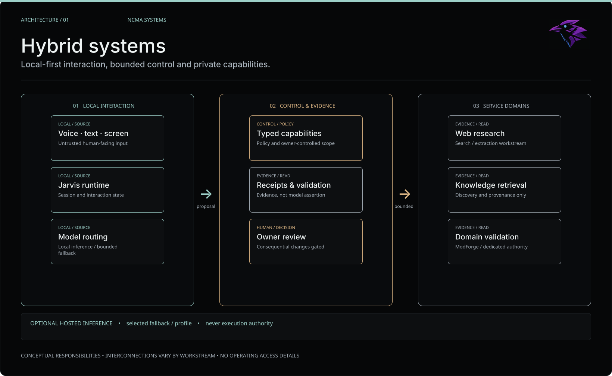
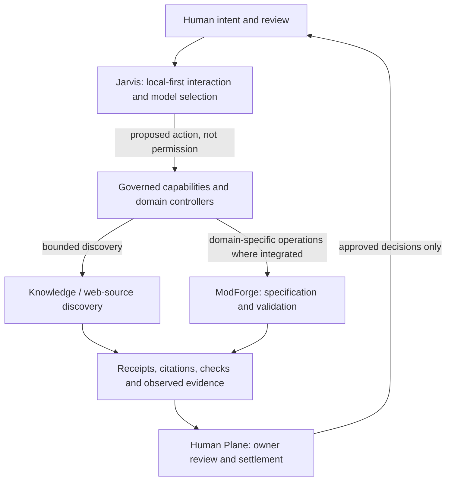

# NCMA Systems | Architecture atlas

**Applied AI Engineering — public, sanitized logical views.**

This section explains *responsibility*, *authority*, *evidence* and *failure handling* across selected NCMA workstreams. It is **not** a deployment map, a complete integration inventory or a claim that the modules form one finished production product.

## Read the system

| View | Engineering question |
| --- | --- |
| [Hybrid systems](hybrid-systems.md) | Where do user interaction, model inference, private capabilities and evidence belong? |
| [Governed execution](governed-execution.md) | How is a proposed tool call separated from permission and a verified result? |
| [Retrieval and provenance](retrieval-provenance.md) | How do private knowledge and web sources become inspectable, bounded evidence? |
| [ModForge and Human Plane](modforge-human-plane.md) | How do specifications move through deterministic checks, runtime observation and owner settlement? |
| [Measurement and qualification](measurement-qualification.md) | Why do benchmark scores, CI passes and product acceptance remain different gates? |
| [Publication review](PUBLICATION_REVIEW.md) | What may be published, and what stays inside the private implementation? |

### Branded architecture preview

Each linked page has its own Figma-authored SVG and a **separate maintained Mermaid diagram** for detailed control paths. The images are generalized, sanitized editorial views, not actual deployment maps or a claim of full system integration. See the [visual asset provenance](assets/README.md) and [publication checklist](PUBLICATION_REVIEW.md).

## System boundaries, not one universal orchestrator

**Diagram semantics:** these are *logical responsibilities and recurring engineering patterns*. The drawing does not assert that every path is currently wired together, deployed on one system or release-qualified. In particular, the public [Jarvis case](../projects/jarvis-v2.md) records outstanding owner acceptance gates, and the [Web Research case](../projects/web-research-v1.md) records pending end-to-end synthesis.

### What the public architecture does not reveal

No IP ranges, machine names, port assignments, private URLs, tunnel routes, identities, token formats, access grants, private capability schemas, queue topics, deployment manifests, raw logs or credentials. Exact network topology and operational attack surfaces are intentionally absent.

### Maturity vocabulary

- **Implemented:** component exists at a documented checkpoint.
- **Tested:** specific tests or observations passed, within their stated scope.
- **Integrated:** an end-to-end component connection was actually observed.
- **Accepted:** the separately defined owner/product gate passed.
- **Pending / unknown:** remains explicitly unresolved.

Read the [evidence register](../EVIDENCE.md) before treating any dated figure as a general guarantee. View-specific statements reference the matching case studies. **Build systems, not demos.**
