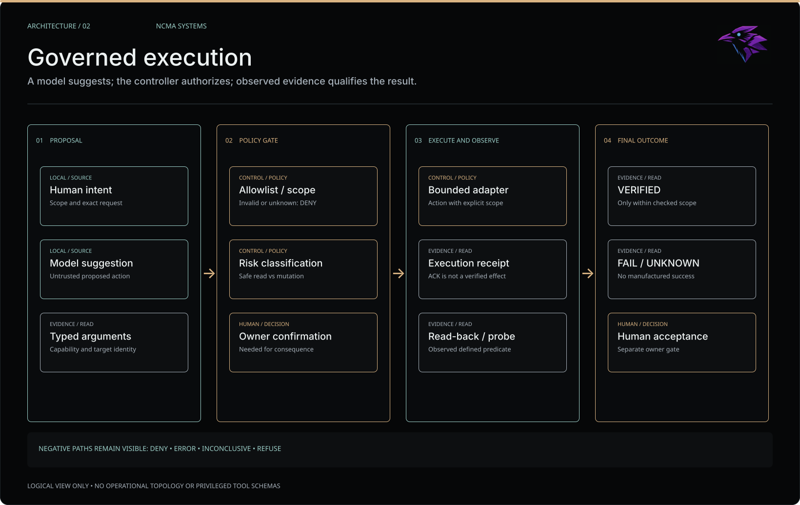
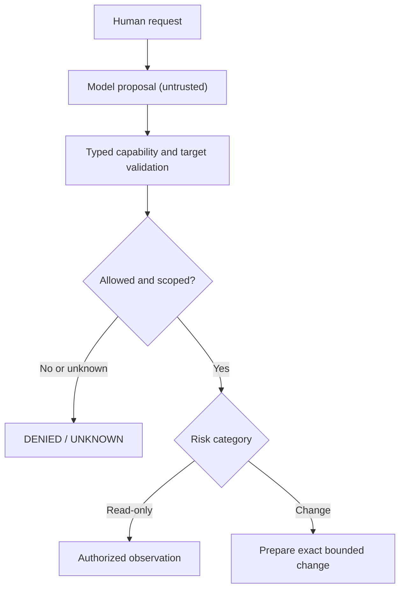
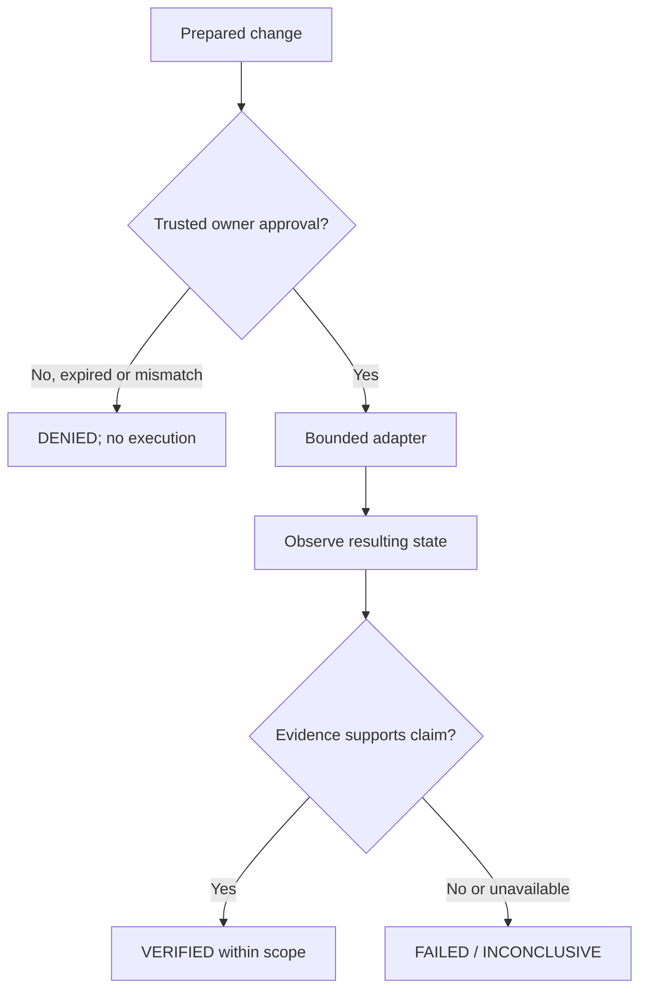

# Governed execution | Proposal is not authority

**Question:** how does an AI system translate a model suggestion into a bounded, auditable action?

The underlying rule is independent of any specific model or deployment: **a model may propose; the controller owns authorization; an observer reports what happened.**

*Figma-authored editorial overview. Logical boundaries only; not deployment topology or proof of a fully integrated runtime. [Visual provenance and publication review](assets/README.md).*

**Maintained Mermaid references:** the governance decision and the change-verification path are separated so neither has misleading crossing arrows.

Flow A: validate and classify an untrusted proposal

*Read-only observation proceeds to evidence verification; preparing a change does not execute it.*

Flow B: approval, execution and evidence

*An execution receipt is not, by itself, independent verification; the evidence requirement applies to read-only and mutation paths.*

## Controller obligations

1. Accept only known, typed capabilities. Natural-language intent does not expand the allowlist.
2. Bind action arguments to an exact target and scope before preparing any mutation.
3. Keep human approval outside the model's response. A model-generated `approved=true` is inert.
4. Handle retries and replays explicitly. Idempotency is a controller responsibility, not a model promise.
5. Distinguish execution acknowledgement from observed state and an independently verified external effect.
6. Emit a truthful status even when an adapter, observer or verification step fails.

## Levels of proof

| Reported outcome | Interpretation |
| --- | --- |
| `DENIED` | The operation was not authorized or its contract was invalid |
| `WAITING_CONFIRMATION` | A change was prepared but **not** executed |
| `EXECUTION_ERROR` | The adapter could not complete the requested operation |
| `VERIFICATION_FAILED` | Execution and observation did not establish the requested state |
| `VERIFIED` | Evidence matches a *defined bounded predicate*, not every possible real-world effect |
| `UNKNOWN / INCONCLUSIVE` | No sufficient basis for PASS |

## Publicly executable reference

[Agent Governance Lab](https://github.com/Ozzurac/agent-governance-lab) demonstrates this idea using an **in-memory notes adapter**. Its read-after-write check is deliberately *not* a fully independent oracle; its plain Python confirmation entry point is *not* user authentication. It has no real shell, browser, gateway or production privileges.

Related private-system case studies: [MCP Gateway](../projects/mcp-gateway.md) and [Jarvis V2](../projects/jarvis-v2.md). Actual tool definitions, grants, confirmation transport and deployment wiring are not public.
