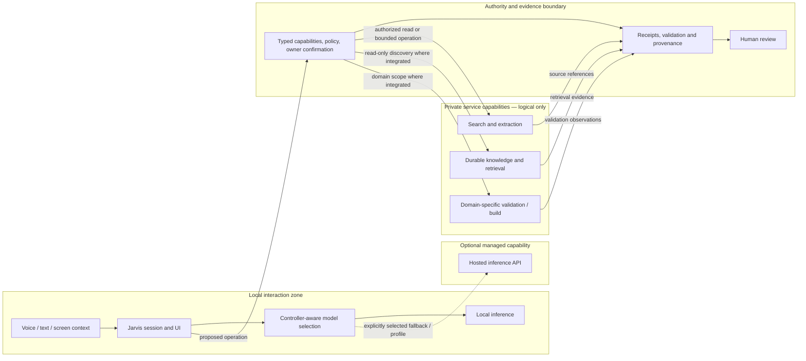

# Hybrid systems | Logical architecture

**Question:** how can local interaction, optional external inference and private service components coexist without giving a model unrestricted operational authority?

This is a **sanitized capability-zone diagram**, not a literal network, runtime service-discovery map or deployment inventory. Boxes describe classes of responsibility, not individual hosts. Arrows describe intended information flow and control boundaries; cross-workstream integration must be separately proven.

## Verified component boundaries

| Workstream | Publicly supportable claim | What is *not* established |
| --- | --- | --- |
| [Jarvis V2](../projects/jarvis-v2.md) | Local-first runtime, voice/model components and controller-governed execution have documented implementation and test checkpoints | Release-ready general autonomous control |
| [Web Research V1](../projects/web-research-v1.md) | Privately hosted search/extraction components were deployed and tested at the cited checkpoint | Accepted full cited-synthesis loop |
| [Knowledge Runtime](../projects/knowledge-runtime.md) | Durable evidence history and a retrieval profile have read-only operational health evidence | Retrieval as final domain truth or proof of cross-product integration |
| [ModForge V2](../projects/modforge-v2.md) | Deterministic validation and independent observation are documented | General proof that every gameplay effect or build is correct |
| [Human Plane](../projects/human-plane.md) | Owner-controlled review and bounded mutation are architecture responsibilities | A standalone autonomous operator |

The exact geographic placement, virtual-machine composition, addresses, access configuration and trust policy are private. **Hybrid** refers here to *classes of computing and model-serving boundaries*, not disclosure of the actual infrastructure diagram.

## Design trade-offs

- Local inference provides an option for resource-aware and privacy-conscious interaction; resource limits may require a separately approved remote model path.
- Hosted inference can assist synthesis, but model output remains **untrusted input** to controllers.
- Private search and retrieval can collect evidence, but evidence *availability* is not evidence *correctness*.
- A backend success response is not proof of the external effect. Verification and human acceptance remain separate stages.
- Failure, missing source or inaccessible validation must preserve **UNKNOWN / INCONCLUSIVE**, not manufacture a PASS.

**Public illustrations deliberately omit operational infrastructure.** See [publication policy](../PUBLICATION.md) and [publication review](PUBLICATION_REVIEW.md).
