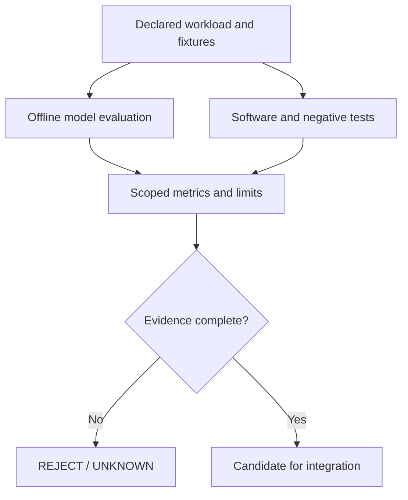
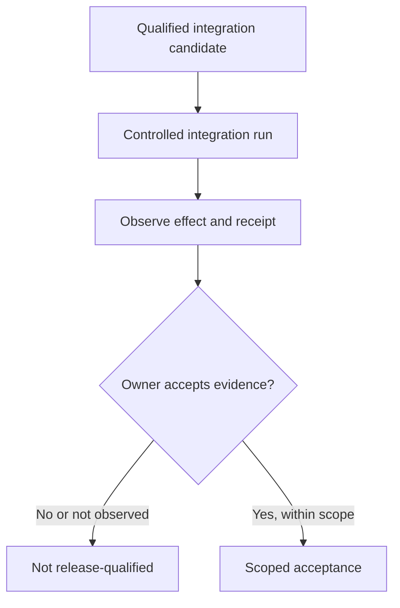

# Measurement and qualification | Different gates, different proofs

**Question:** how can a fast model, a green CI run and a working user-facing system be evaluated without confusing their evidence?

*Figma-authored editorial overview. Logical boundaries only; not deployment topology or proof of a fully integrated runtime. [Visual provenance and publication review](assets/README.md).*

**Maintained Mermaid references:** qualification is divided into **evidence collection** and **owner acceptance**, instead of a large branch-and-merge graph.

Flow A: bounded measurement and test evidence

*Benchmark and CI results are separate evidence categories, even when summarized together.*

Flow B: integration observation and independent acceptance

*Acceptance proves only the declared scope and checkpoint, not future behavior.*

## Keep the evidence categories separate

| Evidence | What it can establish | What it cannot establish alone |
| --- | --- | --- |
| Offline LLM throughput and latency | Resource and performance behavior on a specified workload | Instruction correctness or safe tool execution |
| ASR WER/CER and frozen holdout | Transcription error on declared clips and normalization | General accuracy across microphones, noise or accents |
| Train/dev/holdout separation | Bounded guard against experimental leakage and checkpoint cherry-picking | Absence of semantic contamination or deployment readiness |
| LoRA merge and quantization parity | Behavior survived selected artifact conversions | Safety; the historical diagnostic still showed violating cases |
| Unit and negative tests | A known implementation checks its specified predicates | Correctness in an external runtime |
| Runtime read-back / independent observation | A defined effect was observed within the probe's reach | Every downstream effect or a product-level acceptance |
| Human sign-off | Owner accepts a particular scope and evidence package | Unlimited future behavior outside that scope |

## Public data to inspect

- [Dated evidence register](../EVIDENCE.md)
- [Local LLM benchmark](../projects/local-llm-benchmarking.md)
- [ASR benchmarking](../projects/asr-benchmarking.md)
- [Fine-tuning and export parity](../projects/fine-tuning-evaluation.md)
- [Runnable synthetic metrics and split checks](https://github.com/Ozzurac/ncma-validation-patterns)

**Observability model:** capture a bounded causal chain of **request intent → controller decision → attempted operation → execution result → observed evidence → final claim**. This is a *logical event schema*, **not** an export of operational logs, trace IDs, dashboards or tracing configuration.

Do not treat a sum of overlapping test selections as independent coverage. Do not extrapolate from an offline model benchmark to production acceptance. Missing evidence remains an explicit unknown.
