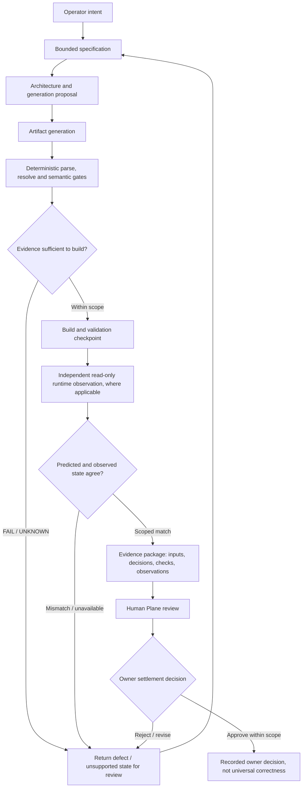

# ModForge + Human Plane | Specification to evidence

**Question:** how does an AI-assisted, domain-specific artifact progress from a request to an effect that can actually be trusted?

ModForge is the **domain engineering and validation** workstream. Human Plane is the **operator-facing review and decision** layer. Neither a fluent generated specification nor a successful compiler response is sufficient proof.

## Responsibility boundaries

| Responsibility | Role |
| --- | --- |
| Specification / generation | Proposed content; **not** permission to deploy |
| Deterministic gates | Enforce defined schemas, domain constraints and explicit refusals |
| Build and validation | Produce bounded technical evidence |
| Runtime observation | Independently inspect selected effective states, **not** all gameplay behaviors |
| Human Plane | Present effective state, consequences, validation evidence and guarded mutation paths |
| Owner settlement | Final human decision on the specific artifact or change |

## Why the separation matters

The V1 incident described in the [ModForge case study](../projects/modforge-v2.md) reported **210 passing checks while three mods were broken**. The V2 response was to distinguish self-consistency from external verification, preserve UNKNOWN and inject defects into validation tests. A later source test pass did **not** automatically promote a production runtime.

The workflow above is **a generalized target lifecycle**, not an assertion that every stage is release-qualified or automatically integrated end to end. Human Plane is not represented as an autonomous agent; it is a layer for **human authority, review and evidence**.

No game assets, private semantic rules, original specifications, specific record identifiers, mutation API, access grants, real build paths or operation tokens are included.

Related: [ModForge V2](../projects/modforge-v2.md) · [Human Plane](../projects/human-plane.md) · [Evidence register](../EVIDENCE.md).
