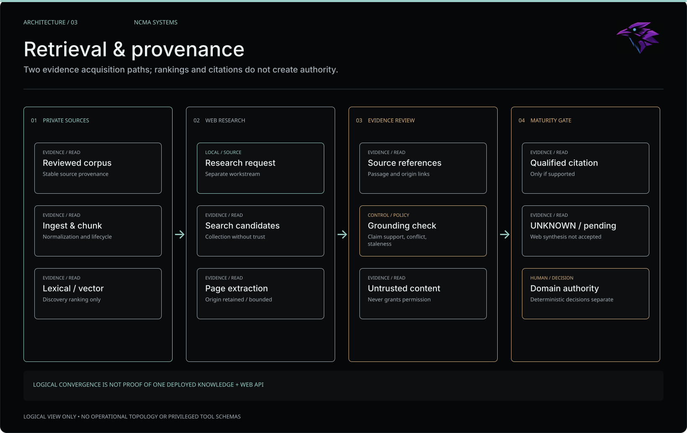
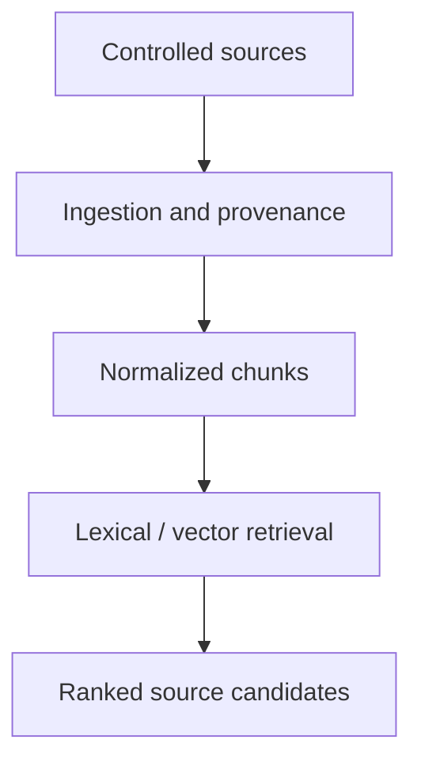
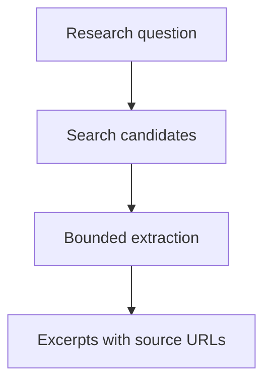
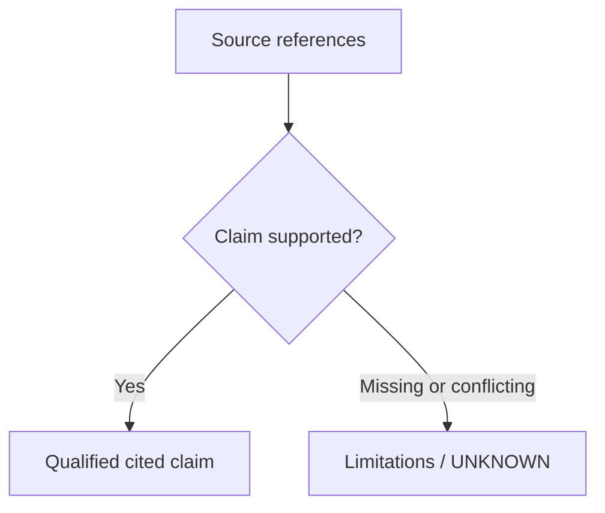

# Retrieval and provenance | Evidence before synthesis

**Question:** what is the difference between finding relevant material and establishing a claim?

NCMA has distinct **internal knowledge retrieval** and **web research** workstreams. Their sources and maturity gates differ. Neither retrieval ranking nor a plausible citation grants execution authority or proves an answer true.

## Two source paths

*Figma-authored editorial overview. Logical boundaries only; not deployment topology or proof of a fully integrated runtime. [Visual provenance and publication review](assets/README.md).*

**Maintained Mermaid references:** the two source pipelines below stay independent. A final *conceptual* evidence gate illustrates how grounded claims should be qualified; it does **not** imply one deployed API combining these workstreams.

Flow A: private knowledge discovery

*Ranking is discovery, not deterministic domain truth.*

Flow B: web research source collection

*End-to-end accepted cited synthesis was still pending at the documented checkpoint.*

Flow C: conceptual claim-support gate

*Source citations provide traceability, not proof by themselves. This gate is a design responsibility, not a claim of completed cross-workstream integration.*

**Logical only:** the converged evidence-assembly box is a design concern, **not a claim that the two paths share one deployed API**.

## Grounded maturity statements

- **Knowledge Runtime:** read-only health on 2026-10-11 confirmed an operating durable evidence plane and an active retrieval profile. Retrieval's declared role was **discovery/ranking only**; domain decisions remain with deterministic authority. This is not a publication of its corpus or implementation.
- **Web Research V1:** at the published October checkpoint, search and extraction were deployed and component-tested. End-to-end local synthesis with accepted citation behavior remained **pending**.
- **Citations:** a source pointer supports traceability, but not the truth of a claim by itself. The system must handle missing, contradictory and stale evidence explicitly.
- **Boundaries:** retrieved text and crawled pages are **untrusted content**, not instructions, credentials or permissions.

## Withheld

Source corpora, original chunks and embeddings, query logs, extracted private documents, database structure, snapshots, indexing configuration, access policy, internal URLs and service identities. This diagram is a generalized information-flow model only.

Further reading: [Knowledge Runtime case](../projects/knowledge-runtime.md) · [Web Research case](../projects/web-research-v1.md) · [Publication boundary](../PUBLICATION.md).
