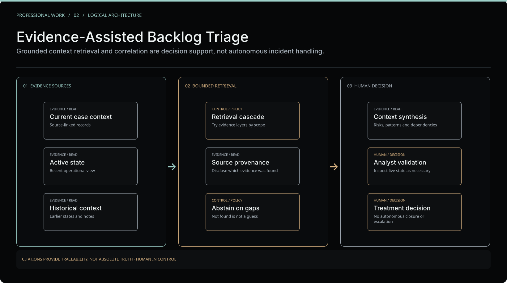

# Professional case study | Evidence-Assisted Backlog Triage

**Area:** Retrieval and grounding · operational context analysis · source provenance · incident correlation · human-in-the-loop decision support

**Context:** Engineering work performed during employment at **Accenture**. This is an independently authored, **sanitized technical account**, not a company-endorsed publication or a public release of employer-owned tooling. Names, sources and architecture boundaries are intentionally generalized.

*Original editorial illustration, not a screenshot or exact reconstruction of an internal deployed system.*

## Challenge

When an analyst investigates a case or a cluster of related backlog records, essential context may be distributed across the current view, previous observations and supporting operational notes. A coherent narrative is often more useful than a collection of disconnected excerpts, but **model plausibility is not evidence**.

The goal was to make context discovery and correlation more useful **while preserving source limitations and the analyst's final authority**.

## My role

I developed an approach for contextualizing operational cases using prepared current and historical evidence, source-aware retrieval and bounded analysis. My contribution emphasized **which evidence was actually available**, how uncertainty was communicated and how analysts could use the result to guide rather than delegate operational decisions.

This represents my individual role in the work, not ownership or authorship of every employer platform involved.

## Context and constraints

- Source material had different degrees of recency, relevance and completeness.
- A model might retrieve an irrelevant fragment or overlook an important one.
- An apparently convincing correlation needed corroboration against referenced material.
- Operational records could change after an answer was generated.
- Incident status changes, communication and treatment remained human-owned.

## Architecture | Sanitized evidence flow

| Layer | Responsibility | Boundary |
| --- | --- | --- |
| Case-relevant context | Provide narrow, source-linked operational observations | Prefer the most pertinent available information |
| Current-state perspective | Describe the latest prepared operational view | Not a substitute for rechecking the authoritative live state |
| Historical perspective | Surface past updates, repeated patterns and related context | Old observations do not automatically describe the present |
| Bounded retrieval | Expand the search scope when evidence is insufficient | A broader search is not a stronger claim |
| Provenance and qualification | Identify supporting sources and material limitations | A citation proves traceability, not guaranteed truth |
| Context synthesis | Suggest dependencies, patterns, risks and lines of inquiry | Analysis is advice, not an instruction to operate systems |
| Analyst review | Validate current conditions and determine the next step | No autonomous closure, escalation or production mutation |

The table describes **logical responsibilities**, not specific corporate datasets, schemas, tools or proprietary retrieval order.

## Engineering decisions

### Retrieve narrowly before broadening

Relevant case-level evidence is easier to inspect and less likely to be drowned out by unrelated history. Broader context may help uncover recurring events or dependencies, but the system should communicate when an answer required widening its evidence scope.

### Make grounding inspectable

Answers should distinguish **observed source content**, **inferred relationships** and **recommended investigation**. An accessible reference alone is insufficient; the cited material must actually support the claim.

### Treat missing context as an explicit result

A response that cannot be supported should say so. It can suggest how the analyst might validate the state or refine the search, but it should never manufacture case history, owners or outcomes.

### Keep decisions with the analyst

AI-assisted correlation is a way to **reduce the effort of finding context**, not a mechanism to bypass incident management controls. Analysts still validate live conditions, assess impact and own the treatment decisions.

## Validation approach

The approach emphasized inspecting cited support, identifying unsupported or stale claims, distinguishing absence of evidence from negative evidence, and keeping operator acceptance separate from response quality.

This public case study **does not claim a frozen benchmark, a validated universal retrieval accuracy, verified production autonomy or independently audited time savings**.

## Result

The workflow supported more structured contextual investigation by bringing source-linked observations into a usable decision-support narrative. It helped relate the broader backlog to specific operational questions while retaining explicit uncertainty and human accountability.

The qualitative outcome is described from professional experience. No unverified percentage improvement or time-to-resolution number is presented as a measured fact.

## Trade-offs and lessons

- Adding more material can increase noise, staleness and conflicting evidence.
- Source attribution is necessary for auditability, but does not automatically establish correctness.
- Independent live-state checks may be necessary even after a well-grounded retrieval.
- Human review is an intentional safety boundary, not an unfinished feature.

## Publication boundary

No real ticket, customer identity, private communication, raw knowledge-base material, retrieval key, employer schema, internal prompt, endpoint, screenshots, logs or access configuration is included. The public figure is a generalized, independently authored design abstraction.

**Companion case:** [Operational Backlog Compliance](operational-backlog-compliance.md) explains the deterministic preparation, reconciliation and historical evidence responsibilities that precede analyst-facing interpretation.

**Site narrative:** [Incident correlation](https://ncmasystems.com/projects/incident-correlation) · [Publication policy](../PUBLICATION.md).
