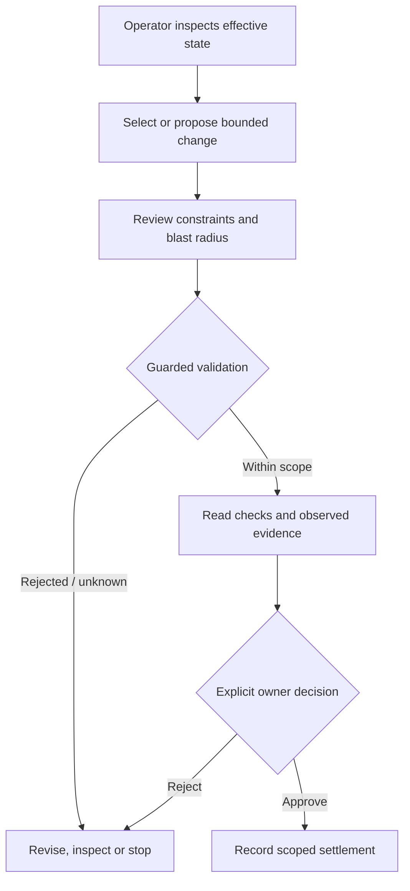

# Case study: Human Plane

**Area:** human-in-the-loop operations, review UX, guarded changes, evidence and decision authority.

**Status:** operator-control workstream associated with the private NCMA / ModForge engineering environment. This case describes its **design responsibility**; no public API, source code or product-acceptance claim is made.

## Problem

A generated artifact or a model proposal can pass syntactic checks and still be wrong in the external environment. Human operators need to see **effective state, limits, evidence and the consequences of a change** before committing to it.

## Logical operator workflow

## Architectural choices

- Keep **human authority** distinct from generated instructions or model confidence.
- Make the prospective effect visible before a consequential operation.
- Bind guarded mutations to a clear scope rather than grant open-ended changes.
- Treat independent observations, failed checks and UNKNOWN states as material to review.
- Preserve the difference between a prepared change, an executed change and an accepted outcome.

## Scope and limits

This document is intentionally **not** a screenshot gallery or reconstruction of the private application. It does not reveal real mutation endpoints, identity roles, token mechanics, privileged tool catalogues, domain-specific payloads or live infrastructure.

**A review interface is not proof that all stages are autonomous, deployed or fully validated.** The responsibility described here is human-controlled settlement, not an independent self-authorizing AI agent.

Related: [ModForge and Human Plane flow](../architecture/modforge-human-plane.md) · [ModForge case](modforge-v2.md) · [Governed execution](../architecture/governed-execution.md).
