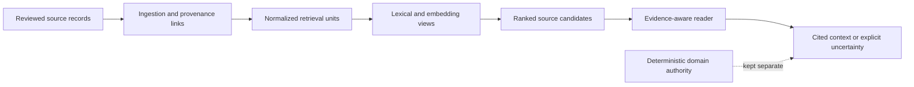

# Case study: NCMA Knowledge Runtime

**Area:** private knowledge systems, retrieval, provenance, evidence lifecycle and deterministic authority boundaries.

**Status:** internal workstream with a **read-only health checkpoint on 2026-10-11**. This public document is an architectural account, **not a product release**, public endpoint or reusable private implementation.

## Problem

An engineering agent needs to recover relevant historical facts, decisions, failure records and source context without treating a confident model answer as durable evidence. Storage, retrieval and domain authority are three different jobs.

## Sanitized design

The active internal health path on the stated date reported a durable evidence plane and an available retrieval profile with indexed material. The retrieval boundary explicitly described its role as **discovery/ranking**, not the final authority for ModForge domain decisions. This demonstrates a live component health surface, **not** a full acceptance test of every downstream consumer.

## Engineering decisions

- Preserve source identity and evidence provenance across ingestion and retrieval.
- Keep discovery relevance separate from deterministic domain validation.
- Represent unavailable or conflicting evidence as uncertainty, rather than implicit PASS.
- Keep private corpus, operational identifiers and privileged tooling behind the publication boundary.
- Validate the lifecycle of knowledge changes independently of the quality of a language-model answer.

## What is not claimed

No public reproducibility of the private corpus; no universal RAG accuracy score; no proof that every consumer is integrated or that every retrieved passage is factually true. The diagrams deliberately omit storage layout, schema names, model-profile keys, embeddings, endpoints and operational infrastructure.

Related: [Retrieval and provenance](../architecture/retrieval-provenance.md) · [ModForge V2](modforge-v2.md) · [Publication policy](../PUBLICATION.md).
