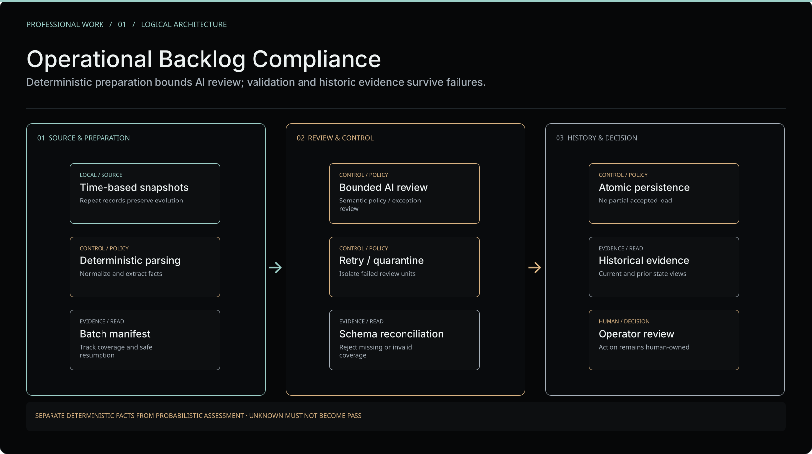

# Professional case study | Operational Backlog Compliance

**Area:** Applied AI in IT operations · deterministic Python workflows · recoverable batch execution · compliance-oriented review · evidence lineage

**Context:** Engineering work performed during employment at **Accenture**. This independently authored portfolio account is **not an Accenture publication, endorsement or public release of employer software**. It reconstructs the engineering responsibilities at a deliberately generalized level. No client system, internal process specification, company source or measurable business outcome is being disclosed.

*Public **logical illustration**, designed in the NCMA V4 Figma portfolio. It is not an exact deployment topology or copy of an internal workflow.*

## Challenge

An operational backlog changes as cases are opened, updated, transferred and investigated. A single latest-state export cannot always explain **how** a case reached its present condition. Reviewing separate daily extracts manually makes consistency, historical accountability and incomplete-processing detection difficult.

The engineering challenge was to support repeatable reviews **without allowing probabilistic AI output to overwrite deterministic facts**.

## My role

I designed and developed Python-based data preparation and validation, and contributed the surrounding automated review workflow. My work focused on deterministic field processing, bounded model inputs, recoverable execution, output reconciliation and an evidence trail usable by operational analysts.

This describes my **individual technical contribution**, not sole ownership of an employer-wide system.

## Constraints

- The workflow had to operate within an existing enterprise tool and permission environment.
- Data could include repeated observations of the same case across distinct points in time.
- Model context and response structure had finite limits.
- Partial, duplicated or interrupted processing could not silently count as a successful review.
- Final compliance interpretation and operational treatment remained with humans.

## Architecture | Sanitized responsibility flow

| Boundary | Engineering responsibility | Expected evidence |
| --- | --- | --- |
| Time-based observations | Preserve successive views rather than deduplicate away history | Reconstructable progression and origin |
| Deterministic preprocessing | Normalize and extract objectively computable facts using Python | Structured facts independent of model reasoning |
| Bounded semantic review | Apply AI to ambiguous narrative, exceptions and suggested follow-up | Explicit review output with scope limitations |
| Execution recovery | Track units of work; isolate, retry or stop on failure | Distinguishable complete, failed and unprocessed states |
| Reconciliation gate | Check expected coverage and accepted output shape | Evidence that an incomplete response was not silently accepted |
| Durable history and reporting | Persist qualified observations and produce analyst-readable views | Inspectable history and decision-support artifacts |

The blocks describe **responsibility classes**, not an exact list of scripts, interfaces, repositories or company integration points.

## Engineering decisions

### Deterministic first, AI second

Dates, normalizable metadata and other reproducible fields belong in ordinary software. The model's value is understanding context that cannot be reliably derived from rules alone. Keeping that distinction lowers wasted reasoning and avoids avoidable disagreement between an AI interpretation and an objective field.

### Repeated observations are evidence

Observations of the same operational case at different times should not automatically be discarded as duplicates. They can describe the evolution of actions, ownership and current state, provided provenance and time context survive normalization.

### Recovery is part of correctness

Bounded work units, resumability and isolated failures reduce the chance that a transient interface or model failure corrupts an entire analysis. A tool response saying “complete” is not enough: expected item coverage and accepted structure must be reconciled.

### Validate before accepting

Output integrity must be checked independently of the model's own assertion. Where a processing unit is incomplete, malformed or unverified, it remains **FAILED, PENDING or UNKNOWN** rather than becoming a false positive.

## Validation and observability

The engineering method emphasized repeatable parsing, expected-versus-observed item reconciliation, auditable failure handling, recoverable execution and transaction-safe persistence. These are the validation **mechanisms described for this work**; this public repository does not contain the company's test suite, production logs or independent acceptance reports.

**No numerical accuracy rate, uptime claim, client impact metric or verified savings figure is asserted here.**

## Result

The work supported a more structured way to prepare, review and retain backlog-compliance evidence. It connected deterministic processing with narrowly scoped semantic analysis while preserving human responsibility for follow-up. Its value is best understood as **controlled operational analysis**, not an autonomous compliance adjudicator.

## Trade-offs and lessons

- Deterministic preprocessing adds code but reduces ambiguity and unnecessary model work.
- Historical fidelity increases storage and validation needs compared with a single current-state report.
- Strict reconciliation can reject a mostly complete output, intentionally prioritizing correctness over optimistic throughput.
- GUI-dependent automation requires defensive failure handling; it does not create the guarantees of a transactional API.

## Publication boundary

This document does **not** include source code, company prompts, field mappings, schemas, individual incidents, protected communications, proprietary process rules, internal access paths, screenshots, cloud diagrams or employer/customer data. The generalized SVG was authored specifically for this portfolio.

**Companion case:** [Evidence-Assisted Backlog Triage](evidence-assisted-backlog-triage.md) explores how validated current/historical context can inform analysts without granting an AI authority to act.

**Site narrative:** [NOC operational audit](https://ncmasystems.com/projects/noc-audit) · [Publication policy](../PUBLICATION.md).
